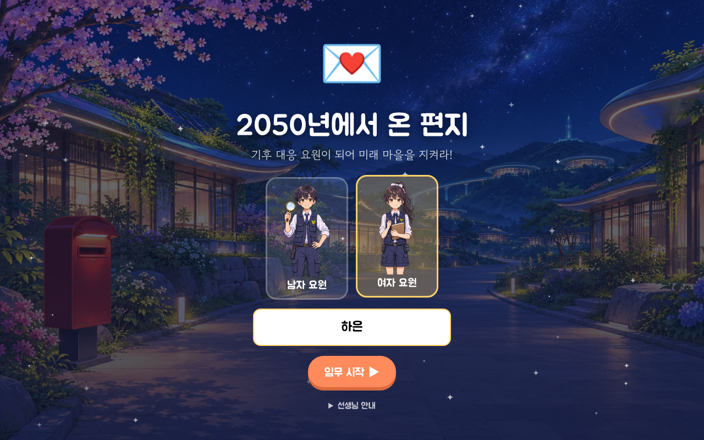
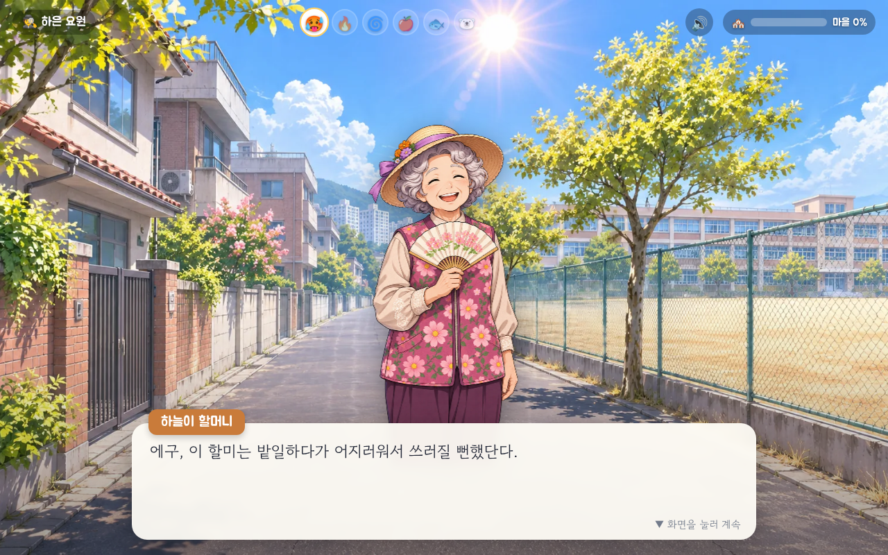
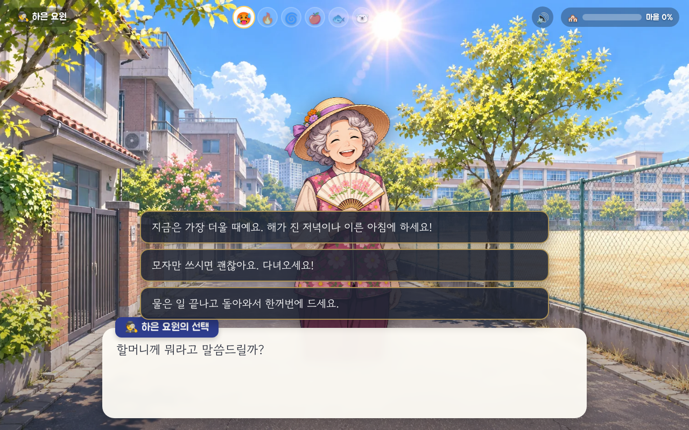
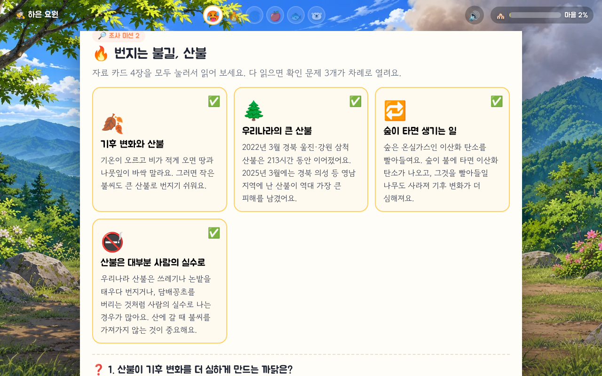
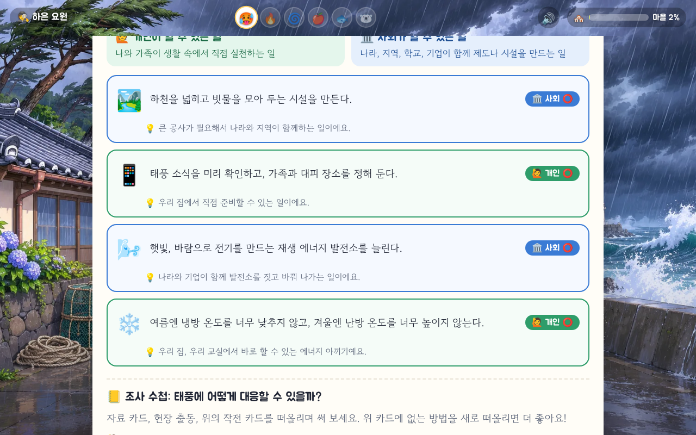
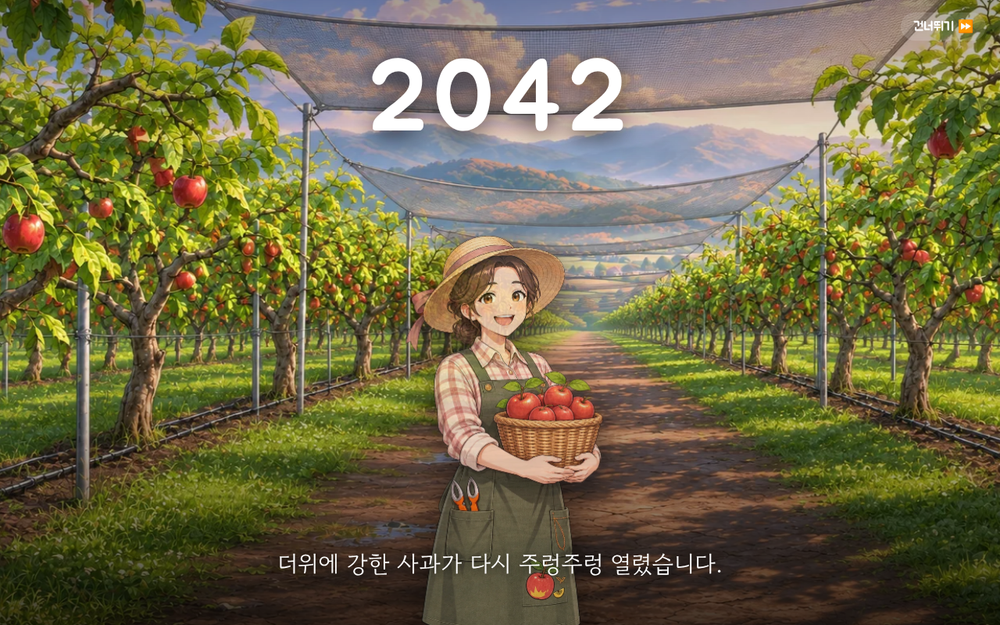
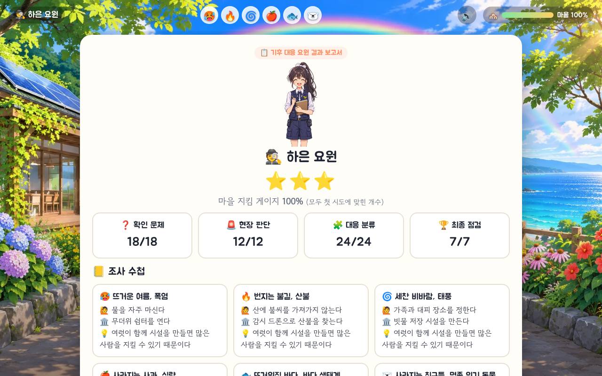

# 💌 2050년에서 온 편지 — 기후 대응 요원

초등학교 4학년 과학(아이스크림 4-2) **「기후 변화에 어떻게 대응할 수 있을까?」** 차시를 위한 비주얼 노벨 수업 게임입니다.

교과서 활동은 태블릿으로 대응 방법을 조사하는 것이 전부라서, 학생들이 이야기 속 인물을 도우며 **조사하고, 판단하고, 정리하고, 약속하는** 흐름으로 만들었습니다.

## 이야기
2050년에 사는 하늘이가 시간 우체통으로 편지를 보냅니다. 학생은 2026년의 **기후 대응 요원**이 되어 6개의 사건을 해결하고 미래 마을을 지킵니다.

| 사건 | 만나는 사람 |
|---|---|
| 🥵 폭염 | 하늘이 할머니 |
| 🔥 산불 | 박 대원(산림 소방관) |
| 🌀 태풍 | 어부 할아버지 |
| 🍎 식량 | 과수원 이모 |
| 🐟 바다 수온 상승 | 해녀 할머니 |
| 🐻‍❄️ 멸종 위기 동물 | 윤 박사 |

## 한 장의 흐름
1. **이야기**: 마을 사람이 겪는 문제
2. **조사 미션**: 자료 카드 4장 읽기 → 확인 문제 3개 (객관식·⭕❌)
3. **🚨 현장 출동**: 이야기 속 선택 미션 2개 (틀리면 이유를 듣고 다시 선택)
4. **대응 작전**: 대응 방법을 🙋 개인 / 🏛️ 사회가 할 수 있는 일로 분류
5. **📒 조사 수첩**: 개인 대응 · 사회 대응 · 그 까닭 쓰기

6장이 끝나면 **최종 점검 퀴즈 7문제 → 나의 실천 약속 + 사회에 보내는 제안 → 하늘이의 손편지 → 에필로그 애니메이션 → 크레딧 → 마지막 영상 → 결과 보고서**로 이어집니다.

| | |
|---|---|
|  |  |
|  |  |
|  |  |

## 수업 운영
- **대상·환경**: 4학년, 1인 1태블릿
- **시간**: 평균 80~90분 → **3차시 권장** (1~2장 / 3~4장 / 5~6장+엔딩)
- **이어하기**: 진행 상황은 태블릿 브라우저에 저장됩니다. 같은 태블릿에서 ‘이어하기’를 누르면 됩니다.
- **제출**: 결과 보고서 화면의 **📸 사진으로 저장하기** → 저장된 사진 제출 (저장 창이 안 뜨는 기기는 사진을 길게 눌러 저장)
- **소리**: 장면별 배경음악과 효과음이 있습니다. 교실에서는 이어폰을 쓰거나 오른쪽 위 🔊 버튼으로 끌 수 있습니다.

## 만든 방식
- 하나의 `index.html` (별도 설치 없음)
- 캐릭터·배경 그림: AI 이미지 생성 도구로 직접 제작
- 캐릭터 움직임: WebGL 그물망 변형 (숨쉬기·고개·머리카락·감정 표현)
- 배경음악·효과음: Web Audio로 브라우저에서 직접 합성 (음원 파일 없음)

## 주의
자료 카드의 수치(홍천 41.0℃, 울진 산불 213시간, 우리 바다 수온 약 1.4℃ 상승 등)는 수업 전에 교과서·지도서와 한 번 대조해 주세요.
